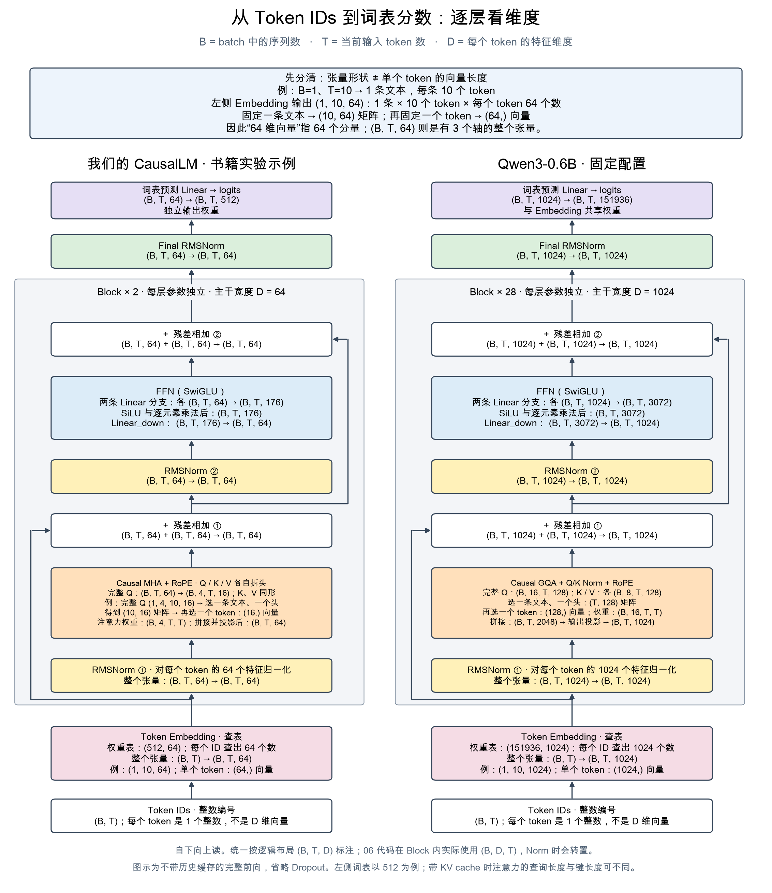

# 07 · 从手写 Transformer 到现代 LLM

我们已有一个能训练、续写、记录指标并使用 KV cache 的小型 CausalLM。现在要解决的问题是：**真实 Qwen 与它到底差在哪些地方？哪些差异属于结构，哪些来自数据和训练？**

第一课从 [lesson.ipynb](lesson.ipynb) 或下面两个命令开始。只读取固定版本配置与运行小矩阵，不加载 0.6B 权重、不调用 API、不产生云费用。无需安装 transformers；已有 PyTorch 环境即可。命令在仓库根目录运行：

```bash
.venv/bin/python 07-modern-llm/inspect_architecture.py
.venv/bin/python 07-modern-llm/gqa_demo.py
```

## 第二课入口：加载真实权重

结构课之后打开 [02 · 真实 Qwen 推理](02-real-inference/lesson.ipynb)。先看流程图与真实回答，再展开输入 ID、首层张量、手动自回归、采样和 KV cache。已有本机 MPS 执行输出；运行方式见 [第二课 README](02-real-inference/README.md)。本课新增可选 `inference` 依赖，首次下载权重到本机缓存。

## 第三课入口：预训练与继续预训练

打开 [03 · 预训练与继续预训练](03-pretraining/lesson.ipynb)。在 Mac 上用 125,312 参数的随机 Qwen3 小配置完成真实训练：文本 A 预训练 → 保存与加载 → 文本 B 继续预训练；另行验证精确断点恢复。包含实际梯度、参数变化、验证曲线和续写，运行说明见 [第三课 README](03-pretraining/README.md)。没有加载官方 0.6B 权重进行更新。

## 本章路线

| 小节 | 要回答的问题 | 状态 |
|---|---|---|
| 01 · 真实模型结构对照 | 配置怎样映射到 Attention、FFN、参数和缓存？ | 已制作；用户自报结构课学完 |
| 02 · 加载小模型推理 | 聊天模板怎样变成输入，如何逐 token 生成、测速度与内存？ | [课件已制作并实测](02-real-inference/lesson.ipynb) |
| 03 · 预训练与继续预训练 | 文本怎样变成 labels，梯度怎样更新参数，保存后怎样继续学？ | [课件已制作并实测](03-pretraining/lesson.ipynb) |
| 04 · SFT 与 LoRA | 对话模板、回答 loss mask、参数高效微调是什么？ | 后续 |
| 05 · CoT 与推理评估 | 中间步骤是否提高正确率，增加多少 token 和延迟？ | 后续 |
| 06 · RL 与 GRPO | 模型自己生成、评分、更新的循环怎么运行？ | 后续 |
| 扩展 · MoE / MLA / 蒸馏 / 量化 | 分别改变结构、训练还是部署？ | 按需展开 |

预训练、SFT、RL 是学习主线，不是所有模型都严格执行一次的固定流水线。CoT 不是新增的网络层；LoRA 是参数更新方式；MoE 是专家结构；KV cache 是推理优化。租 GPU 在具体模型、任务和内存估算明确之后进行。

## 01：先看结构，再沿数据流讲解

打开 [lesson.ipynb](lesson.ipynb)，无需运行就能看到三张内嵌结构图。顺序是：完整模型 → Attention 内部 → GQA 共享关系 → 小矩阵演示 → 配置对照。配置数字用于解释图里的尺寸，不作为猜题。



### 图中的数字从哪里来

我们选 **Qwen3-0.6B**，固定 revision `c1899de289a04d12100db370d81485cdf75e47ca`，与 05 课的分词器来自同一版本。不是声称它是最新模型，也不能把这一份配置当作整个 Qwen 系列的配置。

真实来源：[固定 config.json](https://huggingface.co/Qwen/Qwen3-0.6B/blob/c1899de289a04d12100db370d81485cdf75e47ca/config.json)。实现对照：[Transformers v4.51.3 的 Qwen3 源码](https://github.com/huggingface/transformers/blob/v4.51.3/src/transformers/models/qwen3/modeling_qwen3.py)。本地 `assets/source.json` 记录来源与 SHA256，读取时校验。配置与许可证已保存，可离线学习；源码仅提供链接，不执行远程代码。

| 项目 | 我们的 CausalLM 默认书籍配置 | 此版本 Qwen3-0.6B |
|---|---|---|
| 主体 | Decoder-only、Dense | Decoder-only、Dense（不是 MoE） |
| 层数 | 2 | 28 |
| 隐藏宽度 | 64 | 1024 |
| Q 头数 / KV 头数 | 4 / 4，MHA | 16 / 8，GQA |
| 每头维度 | 16 | 128 |
| Q 投影总宽度 | 64 | 2048 |
| 归一化 | Pre-RMSNorm + final RMSNorm | 同类结构，另有 Q/K head-wise RMSNorm |
| FFN | SwiGLU，隐层 176 | SwiGLU，隐层 3072 |
| RoPE | theta=10000，相邻特征成对旋转 | theta=1000000，参考实现采用 half-split 配对 |
| Embedding / 输出头 | 独立；输出头有 bias | 共享权重；输出头无 bias |
| 词表 | 本次书籍实验为 512 | 配置为 151936 |
| 上下文 | 本次教学窗口 64，满窗口重建缓存 | 配置最大位置数 40960 |

RoPE 两种配对约定经一致的特征排列可以表达对应旋转，但不能直接把两边权重互换。配置的最大位置数也不保证所有长度上生成质量相同。训练语料、训练预算、后训练不能从这些维度直接推断。

## 第一个关键点：hidden_size 不一定等于 Q 总宽度

本课采用常见 `(batch, token, feature)` 排列；06 Attention 内部采用 token 为列，二者需区分。

```text
输入 hidden：    (B,T,1024)
Q 投影：        (B,T,16×128) = (B,T,2048)
拆 Q 头：       (B,16,T,128)
K/V 投影并拆头：(B, 8,T,128)
各 Q 头汇总后拼接：(B,T,2048)
输出投影 W_o：  (B,T,2048) → (B,T,1024)
残差相加：      (B,T,1024) + (B,T,1024)
```

因此不能用 `1024/16=64` 猜每头维度；要读显式 `head_dim=128`。Attention 内部允许改变宽度，只要输出投影回到残差所需的宽度。

## 第二个关键点：GQA 共享的是 K/V，不是 Q

16 个 Q 头对应 8 个 KV 头，每两个相邻 Q 头共享一组 K/V：

```text
Q0、Q1   → K0、V0
Q2、Q3   → K1、V1
…
Q14、Q15 → K7、V7
```

Q0 与 Q1 查询同一份 K/V，但 Q 不同，通常产生不同的注意力权重和输出。不是把 16 个 Q 头平均成 8 个，也不是把现成 MHA 的任意头删除就得到同等效果。

运行 `gqa_demo.py`，用隐藏宽度 16、4 个 Q 头、2 个 KV 头、每头 8 维观察同样关系。随机输入输出都是 `(1,5,16)`，中间 Q 是 `(1,4,5,8)`，K/V 是 `(1,2,5,8)`。为直观展示，代码临时 repeat K/V；真正缓存应保留 repeat 前的张量。这个实验省略 QK Norm、RoPE、FFN，不是完整 Qwen，也不展示其语言能力。

## 第三个关键点：内存要分账计算

标准、未量化 KV cache 的数据存储量：

```text
2（K与V）× batch × token数 × 层数 × KV头数 × 每头维度 × 每元素字节数
```

此配置 B=1、T=1024、每元素 2 字节时为 **112 MiB**。若保持其他量不变，假设改成 16 个 KV 头的 MHA，则为 **224 MiB**。这只是 KV 缓存减半，不是整个模型内存减半，也不保证推理速度翻倍。

```bash
.venv/bin/python 07-modern-llm/inspect_architecture.py --batch 2 --tokens 2048 --bytes 2
```

脚本也按投影、SwiGLU、归一化与共享 Embedding 统计参数。Embedding 和输出层共享时只算一次；Q/K Norm 各有 head_dim 个参数，在头之间共享。输出的 weights_gib 只表示权重数据，不包含缓存、激活、临时缓冲、梯度和 Adam 状态，不能直接用来承诺某张 GPU 足够训练。

## 对照代码与继续学习

Notebook 已包含完整结构、Attention 分支和 MHA/GQA 对照三张图；图片由 `lesson_visuals.py` 生成，并嵌入课件，打开即可阅读。Q/K Norm 与 RoPE 只处理 Q/K，V 不经过它们。

06 的对应位置为 `CausalBlock`、`MultiHeadAttention`、`SwiGLU`；07 的 `TinyGQA` 单独演示共享关系，没有修改 06 模型。

本课先讲结构与计算，不安排猜数字或填空。下一课加载真实权重观察输入、chat template 和生成。教师运行验证不计为用户已独立完成。

## RoPE 频率控制实验

`lesson.ipynb` 已加入真实 Qwen3-0.6B 配置下的频率分布、位置敏感度、人工“前一个 token”注意力实验。使用人工构造的完整 128 维 Q/K，未加载预训练权重；不将控制实验当作真实模型的已学习行为。

```bash
.venv/bin/python 07-modern-llm/rope_frequency_experiment.py
```

三张图与全部 64 对频率、数值结果保存在 `assets/rope-experiment/`。
