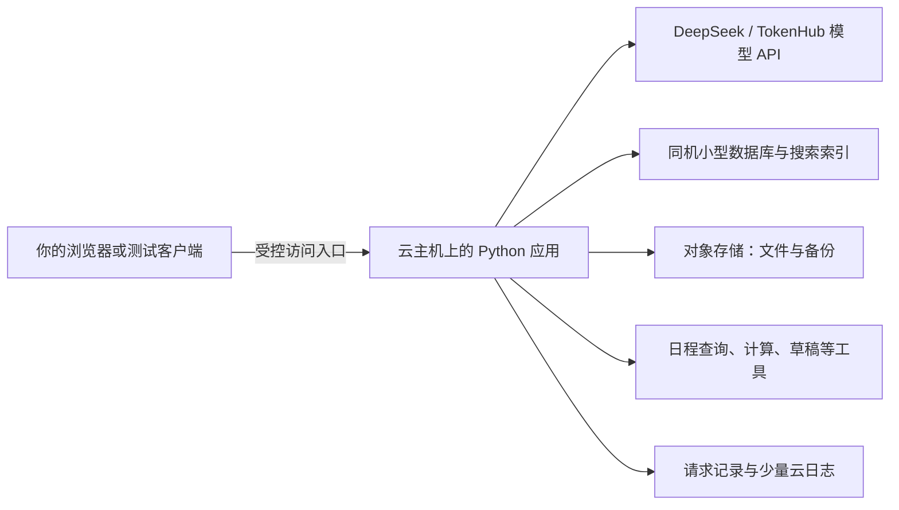

> **历史讨论稿，已于 2026-10-31 被 [面试课程设计](COURSE_PLAN.md) 替代。** 保留用于追溯此前讨论；其中课号、学习时长和客户方案侧重不再作为当前教学安排。

# AI 解决方案架构师学习路线 · 讨论稿

调研与计价基准：2026-10-31。本文是待讨论的课程设计，后续课程尚未制作。已有 `04-trade-inquiry` 外贸课暂停，保留草稿，不作为本路线的默认下一课。

## 1. 从你的现状出发

- 已学：张量、反向传播、MLP、bigram、logits、softmax、损失和温度；课程 3 的消息、响应和 JSON 练习已完成。
- 尚待实践：用自己的凭证完成真实模型调用，持续记录模型表现；不能把人工返回样例视为模型效果。
- 云经验：用过一些云服务器、Docker 和数据库，希望边做项目边补原理。
- 设备与账号：Mac M1 Pro / 16GB；已有 DeepSeek、腾讯云 TokenHub 接口条件。
- 方向：通用的大模型 / Agent 解决方案能力，包括与客户沟通、方案设计、实现、验证、部署和讲解。外贸是未来可选应用方向。
- 预算：整个学习项目的云资源总支出约人民币 1000 元；本稿按更保守口径，将模型 API、检索和多模态调用也计入。
- 节奏假设：后续约 16 个能力单元，合计约 60 小时，含练习；每周 5–7 小时，约 9–12 周。长单元拆成两次学习，每次先在约 30 分钟内看到一个可观察结果。

## 2. 调研后确定的课程原则

课程要围绕这些能力组织：判断问题是否值得用 AI、为任务选择模型、连接资料和工具、验证效果、部署并维护服务、说明成本与取舍。

这与当前 AWS 的生成式 AI 生命周期、Azure 的 AI 应用架构、Google 的 RAG 基础设施设计方向一致：业务范围、模型、数据、集成、部署和持续改进需要一起考虑。课程在腾讯云做主要实验，使用通用名称解释组件，并对照其他云的等价概念。[AWS 生命周期](https://docs.aws.amazon.com/wellarchitected/latest/generative-ai-lens/generative-ai-lifecycle.html)、[Azure AI 架构](https://learn.microsoft.com/en-us/azure/well-architected/ai/architecture-pattern)、[Google RAG 架构](https://docs.cloud.google.com/architecture/rag-genai-gemini-enterprise-vertexai)

1. **每课一个完整能力。** 例如“把模型做成一个能访问的服务”，而不是仅填一行读取 JSON 的代码。
2. **每个新组件都有理由。** 先遇到问题，再解释组件为什么存在、有什么替代办法、是否值得引入。
3. **真实模型从下一课开始。** 公开资料优先使用真实来源；没有业务系统时可模拟数据和动作，但模型、查询、计算和保存程序实际运行。
4. **效果与费用从第一版开始记录。** 每次比较注明模型、输入、参数、日期、耗时、用量和失败原因；服务商通道不同不等于底层模型不同。
5. **云在前五个新单元内进入。** 第一遍做受控的小服务，后面再加数据、权限、恢复和性能实验。
6. **基础按问题补。** Python、HTTP、SQL、网络、attention、embedding 等，在需要解释结果时加入短实验。
7. **当前实现按当前文档。** 模型、接口、协议、价格在开课前核实；固定依赖版本并保存实验日期。基础原理与设计方法不因年份较早而自动失效，也不能用最近一次文档修改时间冒充课程重新发布。

## 3. 三类小项目，练不同能力

### A. 多模型实验台：看懂能力、格式与选型

准备公开的短文章、产品说明、图表或海报，以及有检查依据的小任务。让两个不同模型分别生成、总结、抽取和读图，观察何时正确、何时信息不足、何时把假设写成事实。为结果增加一个简单界面，保存每次实验。

可见成果：真实回答、错误案例、模型对比记录、可运行的服务。趣味来自实际挑战与反例，而不是给普通练习换一个游戏名字。

### B. 资料研究助手：给出能追溯到原文的结论

使用公开产品手册、软件文档和报告，回答跨文档问题。刻意选入不同版本、相互冲突和答案缺失的材料；涉及价格、规格等时保留来源与日期。比较“直接发整段资料”和“先找相关片段”的效果与费用。

可见成果：文件与版本记录、检索结果、带出处的回答、失败分析。再增加两个模拟用户，验证用户只能读取自己的资料；访问限制由应用执行。

### C. 活动安排助手：把建议变成可核对的操作

给定成员日程、场地、时间和预算，查询空闲时段、用程序计算费用、保存活动草稿，并处理改期。日程和场地可以模拟，查询、计算、数据库写入和任务恢复真实执行。

可见成果：可恢复的任务、操作记录、固定流程与 Agent 的对比。先保留为草稿；对外发送、购买和预约不属于自动执行的默认范围。

毕业项目可从以上项目扩展，也可重新选题。行业选择放在通用能力形成之后。

## 4. Roadmap：续接课程 4–19

0–3 的学习成果保留。下表为后续 16 个能力单元，编号表示学习顺序，不表示已经生成了对应课件。

| 课 | 核心问题 | 主要实验 | 完成时能展示什么 |
|---|---|---|---|
| **4 · 真实模型能做什么** | 从学过的语言模型到真正的应用，中间发生了什么？ | 接入已有 API，做生成、摘要与有明确限制的信息抽取；观察失败、截断、用量和不同回答 | 一次可解释的完整调用，加一组真实成功与失败记录 |
| **5 · 把复杂输入变成可用结果** | 读懂一张海报后，程序怎样使用其中的信息？ | 海报/截图 → 日期、地点与条件 → 格式检查与原图核对；加入图文冲突；区分普通 JSON 与接口实际支持的结构约束 | 能区分“格式合法”“字段符合约定”“事实正确”，不只重复上课的 JSON 语法 |
| **6 · 为任务选择模型** | 哪个模型更适合，怎样用数据说明？ | 至少两个不同模型完成同一小组题目，事先定义评分依据；记录质量、耗时、输入输出用量；少量人工复核 | 一张有测试条件和失败案例的选型表，能说明质量、速度与费用取舍 |
| **7 · 从 Notebook 到服务** | 代码在自己电脑上能跑，别人怎样调用？ | 把已有功能做成一个小 HTTP 服务和简单界面；用容器复现；补请求、响应、进程、端口和配置的关系 | 从另一进程调用服务；说明浏览器、后端与模型分别做什么 |
| **8 · 第一次部署到云端** | 哪些放本机、哪些放云上，为什么？ | 云主机运行应用；经受控入口访问；模型 key 只留后端；配置基本访问限制、日志和预算提醒，验证重启 | 第一张实际架构图、一个云端演示、资源与费用记录；云主机运行应用，大模型由 API 服务运行 |
| **9 · 文件和数据怎样管理** | 原始资料、用户数据和搜索索引为什么要分别保存？ | 资料研究助手导入文档，记录来源、版本与所属用户；用对象存储放文件、SQL 保存结构化数据；生成可重建索引 | 一条能重新导入、更新和备份的小型数据流程，解释三种存储的用途 |
| **10 · 先找资料，再回答** | 找不到资料和模型答错，怎样分别改进？ | 对比整段上下文、关键词与语义检索；按需要增加混合检索/重排；核对答案存在、缺失、冲突、过期与用户范围 | 带出处的回答；检索与生成各自的检查结果；能说明什么时候不需要复杂 RAG |
| **11 · 让工具真正办事** | 模型说“算好了、保存了”，程序是否执行过？ | 活动助手调用日程查询、预算计算、保存草稿；验证参数与权限；防止重复写入 | 模型提出调用 → 程序执行 → 返回实际结果的完整记录 |
| **12 · 连续任务怎样保存和恢复** | 做到一半失败、刷新页面或用户改要求怎么办？ | 用明确步骤组织任务；保存当前业务状态与执行进度；模拟失败并继续；介绍等待任务与立即返回的区别 | 一个可恢复的固定流程，说明哪些步骤可以重试、哪些写入不能重复 |
| **13 · 什么时候值得使用 Agent** | 预先写好流程和让模型选择下一步，各适合什么？ | 在同一组任务上比较两者；限制可用工具、最大步骤与费用；观察停止、追问和工具失败 | 依据成功情况、调用次数和费用解释选用理由，而非只展示能自主运行 |
| **14 · 模型应该记住什么** | 数据库里有记录，为什么模型还会漏掉信息？ | 比较完整历史、摘要、当前任务状态与按需找回的偏好；测试改期、撤销要求和长对话 | 画清“完整记录”“业务状态”“本次输入”的区别；说明压缩省了什么、丢了什么 |
| **15 · 工具怎样被复用** | 换一个助手时，是否又要重写接入？ | 把一个已有查询工具提供为 MCP 服务，再由第二个客户端调用；对照或加做一个按需加载的 skill | 解释 MCP 的连接职责与应用的权限职责；理解 skill、工具函数和协议各自用途 |
| **16 · 云网络与资料权限** | 数据库该对谁开放，用户能否拿到别人的资料？ | 在短时 CVM 实验中验证数据库端口只准应用主机访问；核对 VPC/子网/安全组；验证 RAG 权限过滤与不可信内容处理 | 一张访问边界图、允许与拒绝的测试证据；身份和资料权限此前已使用，本课深入验证 |
| **17 · 服务慢了或坏了怎么办** | 请求失败、用户增加、模型升级后怎样定位影响？ | 串起模型、检索和工具的运行记录；复用检查题；注入超时、服务重启与重复请求；分别测缓存或并发改变的效果 | 能指出慢在哪、错在哪、钱花在哪；演示一次恢复与版本回退。该单元拆成两次学习 |
| **18 · API、本地模型与云服务怎么选** | 自己运行模型、购买模型 API、用常驻服务或按需运行各有什么代价？ | 必做：在 Mac 试一个适配的小型量化模型，同任务比较质量、内存和速度；方案对照：常驻应用与 Serverless。短时 Serverless 动手是加做 | 一张选型与费用表；分清模型托管方式与应用托管方式，理解小模型演示不能证明大规模私有部署能力 |
| **19 · 完成一份解决方案** | 怎样把技术结果讲成客户能评审的方案？ | 选一个场景，写一页需求和成功标准，比较两种可行架构，演示系统，列效果、费用、限制及下一阶段计划 | 架构图、可复现演示、检查报告、费用表和 5 分钟讲解；说明何时继续优化、何时值得考虑微调 |

第 5 课只围绕“海报中的信息能否可靠使用”展开；第 15 课以一个 MCP 实验为主，skills 不扩成另一套框架课；第 16 课只验证一个清楚的网络边界。第 18 课将本地模型实测与云服务纸面对照区分，避免一次引入三套部署体系。

流程与 Agent 的区分，以及结构化输出、状态保存等设计，参考当前实现文档，但课程先让你看懂普通 Python 的数据流，再决定何时使用框架。[流程与 Agent](https://docs.langchain.com/oss/python/langgraph/workflows-agents)、[结构化输出](https://docs.langchain.com/oss/python/langchain/structured-output)、[状态保存](https://docs.langchain.com/oss/python/langgraph/persistence)

检索、回答依据和事实正确性分开检查；自动评分只是辅助，保留人工核对与未参与调试的题目。[Ragas 当前评测教程](https://docs.ragas.io/en/stable/getstarted/rag_eval/)

## 5. 原理与工程基础怎么补

| 遇到的现象 | 对应短实验 | 学到的程度 |
|---|---|---|
| 字数与费用对不上，首次返回和完整回答时间不同 | 观察 token、输入处理与逐步生成，比较思考/非思考模式的实际用量 | 能读懂 API 用量和延迟，不凭字符数直接推费用 |
| 同义句没有共同关键词却能被找到 | 句子向量、相似度和一个小检索对比 | 解释 embedding 的作用与局限 |
| bigram 只看一个字符，大模型为什么能参考一段话 | attention 与 Transformer 数据流的小实验，联系已有矩阵知识 | 看懂主要数据流，不要求重新训练大模型 |
| 历史越长越慢，删掉历史又会忘 | 当前输入、缓存、摘要与按需检索对比 | 解释上下文预算和状态之间的关系 |
| 本地模型内存不足或速度不够 | 小模型量化前后或不同规格的内存/速度记录 | 理解权重、运行缓存和吞吐，不把“参数更少”当成唯一选型依据 |
| 云部署与本地运行不同 | 进程、端口、配置、持久磁盘、网络与身份的现场检查 | 能定位基本问题，解释架构组件 |

Python、HTTP、SQL 与容器不另设很长的前置课程；按需要补概念。已经会的部分直接做验证。

## 6. 云实验如何安排

推荐先以腾讯云作为实际部署平台，因为你已有腾讯云 TokenHub 账号和接口条件。课程不要求同时注册并部署三家云；AWS、Azure、Google 的公开架构用于比较通用设计思路。

### 长期保留的小环境



- 云主机承担应用和小型数据服务。主线不在 CPU 云主机上加载大型模型。
- 第一遍通过受控通道使用；例如 SSH 隧道，不需要立即购买域名。公开网站、HTTPS、地域与访问条件在对应部署单元按实际环境核实。
- 数据库与索引初期在同机运行，模型调用独立记账。这个教学环境不等于多机高可用生产环境。
- 文件原件与备份可放 COS；上传内容控制在小规模，保留删除办法。
- 早期就记录请求、用量和异常；第 17 课再增加跨步骤追踪。可参考当前 [OpenTelemetry GenAI 约定](https://github.com/open-telemetry/semantic-conventions-genai)，不强制购买日志平台。

### 单独的短时云实验

轻量服务器负责主要演示；学习自定义 VPC、子网和安全组时，另做一个限时 CVM 实验。两者的能力边界需要讲清，不能把轻量防火墙实验当作完整 VPC 实验。

短时 CVM 与可选 Serverless 实验合用 100 元额度。开课时先取得地域、实例、磁盘、网络等组合报价，再决定规模和时长。超出额度就缩小实验或保留为方案比较，不追加未经讨论的预算。

Serverless 按需运行可能适合低频短任务，不能一概说更贵或更便宜；模型请求等待时间、网络和其他存储服务仍要计费。托管数据库则用官方计算器取得组合价格，再与同机数据库比较。[SCF 计费](https://cloud.tencent.com/document/product/583/12281)、[PostgreSQL 计费](https://cloud.tencent.cn/document/product/409/49577)

## 7. 1000 元总预算

假设从第一次上云起使用至多 3 个月。以下不依赖新人优惠，也不把赠送额度当成必要条件。购买时仍须以所选地域的可售配置和订单页为准。

| 用途 | 分配金额 | 依据与边界 |
|---|---:|---|
| 国内轻量服务器 | 285 元 | 入门型 2 核 8GB、80GB SSD、7Mbps、800GB/月流量，公开原价 95 元/月 × 3 |
| 模型 API 与相关实验调用 | 400 元 | 自定总额度，包含模型对比、评测、工具循环、读图及按需搜索/向量等；不是某款服务套餐价格 |
| COS 文件与备份 | 40 元 | 自定额度，覆盖少量存储、请求和下载；不是固定月费 |
| CLS 日志实验 | 30 元 | 自定额度；平时先用应用自身日志，云端只采集少量必要记录 |
| 短时 CVM / 可选 Serverless 实验 | 100 元 | 自定额度；具体报价与时长在实验前确定，课程后释放资源 |
| 机动余量 | 145 元 | 未预期用量、流量或配置调整；不是必须花掉的部分 |
| **合计上限计划** | **1000 元** | **预算计划，不是平台的自动封顶承诺** |

服务器报价来自腾讯云当前公开价格页，1–5 个月没有时长折扣。若资源实测允许，2 核 4GB 的 65 元/月方案可把三个月服务器支出降为 195 元，节省的 90 元继续保留。[轻量价格总览](https://cloud.tencent.com/document/product/1207/73452)

COS 中国大陆标准存储公开价为 0.118 元/GB/月，外网下行为 0.5 元/GB，请求另计。仅作量级示例：10GB 保存三个月的存储费为 3.54 元，不含请求、下载和其他功能。CLS 按写入、索引、存储等分项计费。[COS 价格](https://buy.cloud.tencent.cn/price/cos)、[CLS 计费](https://cloud.tencent.com/document/product/614/45802/)

### 模型费用的量级例子

当前 DeepSeek `deepseek-flash` 高峰时段、输入未命中缓存时，每百万输入 token 为 2 元、每百万输出 token 为 8 元。按这个较保守的价格，假设非思考文字调用共 2000 次，每次实际计费输入 4000、输出 1000 token：

```text
输入费用 = 2000 × 4000 ÷ 1,000,000 × 2 = 16 元
输出费用 = 2000 × 1000 ÷ 1,000,000 × 8 = 16 元
两项合计 = 32 元
```

这只是固定假设下的一档模型示例，不是整个课程的账单预测。其他模型、额外思考输出、长历史、自动评测、图片与工具会改变用量或单价，分别计入 400 元调用额度。TokenHub 同名系列也要按具体模型 ID、供给版本和地域核价。[DeepSeek 价格](https://api-docs.deepseek.com/zh-cn/quick_start/pricing/)、[TokenHub 价格](https://cloud.tencent.com/document/product/1823/130055)

调研时 DeepSeek 价格页还注明 Search/Fetch 独立按请求收费，接入 Agent 工具的相关调用从 2026-11-01 起开始收费。未来课程若使用此服务，应与模型 token 分开记录，不能沿用“工具免费”的旧假设。

### 怎样守住总额

1. 只在到达部署课时开始购买服务器；先买一个月，用到下一阶段再续，按总计三个月做预算，不提前买全年。
2. 模型逐步充值；每个实验预设调用数、最大输出、Agent 步数和超时时间，不无限循环或无限重试。
3. 每周登记实际账单、已购买时长、剩余额度及待结算的估计。累计支出与已承诺费用接近 850 元时，先暂停新增消耗，核对余量。
4. 云预算提醒用于通知，不能当自动断电或硬封顶；应用自己的调用限制也不能替代云账单核对。[预算管理](https://intl.cloud.tencent.com/zh/document/product/555/44232)
5. 轻量包月期间，关机不会暂停套餐时长。CVM“关机不收费”只在满足条件且选择对应方式时停止部分计算费，磁盘、网络等仍可能收费。[轻量计费](https://cloud.tencent.com/document/product/1207/44368)、[CVM 关机规则](https://cloud.tencent.com/document/product/213/19918)
6. 短时实验完成后检查计算实例、云盘、快照、镜像、EIP、存储和日志等是否仍保留；关闭不需要的自动续费。删除应用进程不等于删除计费资源。

若学习周期超过三个月，优先备份、释放演示环境，回本机继续；重新部署前重算剩余预算。

## 8. 当前技术怎样取舍

**必修并实际操作：** 真实模型 API、输入与输出约定、模型比较、图文输入、资料处理与 RAG、工具执行、固定流程与 Agent 对比、任务保存、上下文、基础 MCP、云端部署、权限、记录与恢复、费用核算。

**小实验或选读：** skill 的组织方式、Serverless、一个本地量化小模型、缓存、混合检索与重排；微调的适用条件。小模型本地实验参考 Apple Silicon 的 [MLX LM](https://github.com/ml-explore/mlx-lm)，具体模型按内存和实际支持情况选，不预先保证某个大模型能在 16GB 上顺畅运行。

**后续根据需求再展开：** 多 Agent、浏览器操作、实时语音、GraphRAG、复杂长期记忆、微调实操、托管数据库迁移、Kubernetes 和 GPU 集群。主线不以把所有热门工具用一遍作为完成标准。

MCP 当前 latest 指向 2026-07-28 规范，部分扩展是可选的。课程只做基本连接和一个能解释用途的例子；Skills 的资料加载与脚本组织作为对照。协议和打包格式不会自动解决业务正确性与授权。[MCP 规范](https://modelcontextprotocol.io/specification/2026-07-28)、[Agent Skills](https://agentskills.io/home)

## 9. 每课的形式与毕业标准

每课的顺序：说明要帮谁解决什么 → 列出已有材料 → 做出第一版 → 加入一个会让它遇到困难的输入或故障 → 比较可行办法 → 记录效果、费用和取舍。

不预设模型必须犯某一种错，也不预设增加某个框架一定提升效果。固定原始输出，用人工可检查的事实验证。每几课做一次两分钟讲解：这个组件为什么需要、取消后会怎样、还有什么方案。

讲义与实验仍可采用 Jupyter；当功能变成服务时，关键实现放到可运行的 Python 项目中，Notebook 用于分析和对比。每课保留少量关键填空，语法与通信细节不作为主要难点。作业沿用 1 简单、2 中等、1 思考的形式，但题目围绕当课实际交付。

完成路线后，应能交付：

- 一个真实调用模型、可运行和复现的小规模应用；
- 一张能解释请求、数据、工具和身份流向的架构图；
- 一份包含失败情况、测试条件和未见题目的效果报告；
- 一份基于实际用量和当前价格的费用表；
- 一次故障定位与恢复演示；
- 一份给客户看的需求、方案比较、实施顺序和五分钟讲解。

这是一条入门到可独立完成小型方案的路线，不把模拟项目的功能正确当成已验证商业需求，也不以课程结业承诺企业规模部署经验。
