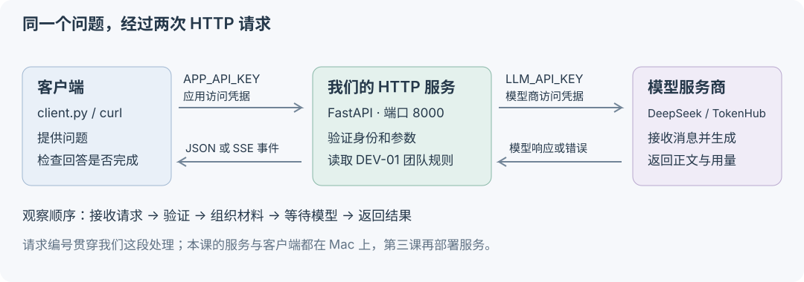

# 第 02 课 从模型调用到 HTTP 服务

第一课已经有了“组织消息、请求模型、检查结果”这条链。你觉得难度偏低，我们直接进入服务开发：**让另一个程序调用这项能力，并在正常与失败情况下得到明确的结果。** 不需要补交第一课，也不先推导模型公式。

终点预告：打开两个终端，一个运行服务，一个扮演使用者；看到完整回答与逐段返回的回答；然后制造一次上游限流和流中断，沿请求编号解释它们。最后你自己增加一个跨接口的小功能。分三次完成也可以，不要求一次读完全部代码。

## 1 我们已有的东西 怎样交给其他人用

现有材料还是第一课的 `DEV-01` 设备借用规则。本课把同一份规则放在服务的 `data/device-loan.md`。没有新行业背景，也没有自动检索：仍由程序选定这份材料。

其他程序不应该知道我们的 Python 函数名、模型商密钥或资料文件路径。它只需要知道“向哪个地址，提交什么，能得到什么”。这个约定就是本课要建立的接口。



注意两次请求是独立的：

1. 客户端 → 我们的服务：带 `APP_API_KEY`，说明它获准调用这个练习服务。
2. 我们的服务 → 模型商：带 `LLM_API_KEY`，由我们的服务账号调用模型并承担用量。

客户端的应用密钥不转发给模型商；模型密钥也不随回答返回。练习中的单一应用密钥只是简单访问控制，不等于完善的用户身份系统。

### 先把服务启动起来


在 VS Code 打开本课目录的终端，执行：

```bash
uv sync --locked
uv run python configure.py
uv run --env-file .env uvicorn service.main:app --host 127.0.0.1 --port 8000
```

`uv sync --locked` 按已保存的依赖版本安装；`configure.py` 配置你的已有账号；最后一行启动进程并监听本机 8000 端口。终端一直占用是正常现象，按 `Ctrl+C` 停止。

第一次运行配置脚本会生成本课的 `.env`。已有配置时直接启动；改了配置要重启服务，新环境变量不会自动进入已运行进程。不要把密钥贴到讨论里。

我们给本课独立环境，是为了把后续部署所需的依赖控制在服务本身；不是因为你已有的 `llm-from-zero` 内核不能用。现在运行的是长期服务进程，不再依赖 Notebook 的单元执行顺序。

### 第二个终端 先问进程活着没有

同样进入本课目录：

```bash
curl -i http://127.0.0.1:8000/health
curl -i http://127.0.0.1:8000/ready
```

你应看到 `200` 和 `model_checked: false`（配置不完整时 `/ready` 为 503）。这两次不调用模型，所以它们返回快，也不证明模型密钥有效、模型额度充足或模型商在线。

这就是一个真实的排错分层：进程能响应、配置字段齐全、外部模型实际可用，是三个不同判断。若需要监测上游，应该设计单独的低频检查，不能让每次健康探测都触发一笔模型费用。

## 2 从一条业务请求追到模型响应

运行一次：

```bash
uv run --env-file .env python client.py
```

这是本课第一次真实模型请求。客户端把下面这份 JSON 发给我们的 `/ask`：

```json
{"question":"便携显示器最多能借多久？续借是自动批准吗？","max_tokens":512}
```

观察终端中的 HTTP 状态、`request_id`、`source`、回答和 `usage`。在运行服务的终端，找到相同的 `request_id`，应出现 `model_start` 和完成或错误记录。模型回答本身不写入服务日志。

下面才开始看代码，顺序只走这一条请求：

| 位置 | 输入 | 做什么 | 输出交给谁 |
|---|---|---|---|
| `service/contracts.py` 的 `AskRequest` | 客户端 JSON | 检查问题类型、长度、输出上限、未知字段 | `/ask` 得到经过检查的对象 |
| `service/main.py` 的 `authorize` | 应用访问凭据 | 判断调用者是否可使用服务，配置是否齐全 | 放行，或在调用模型前返回错误 |
| `service/main.py` 的 `ask` | 问题对象与请求编号 | 调用模型通信函数，记录本次结果 | 客户端 JSON |
| `service/provider.py` 的 `payload` | 问题、服务端规则、上限 | 组织模型消息；服务端控制模型和参数 | 模型 HTTP 请求 |
| `service/provider.py` 的 `complete` | 模型响应 | 检查状态、结构、正文和结束原因 | 完整答案，或明确的服务错误 |

FastAPI 负责路由与校验，HTTPX 负责向另一个 HTTP 服务发请求，Uvicorn 负责让这个应用作为服务运行。名字无需先背，沿刚才的输入输出找它们的职责。

返回也有约定：`AskResponse` 定义回答、模型、用量、时间和请求编号这些字段，`response_model=AskResponse` 让接口文档能展示它们，并检查输出结构。结构合法仍不等于回答事实正确。

### 为什么用了 async 和 await

打开 `/ask` 中这行：

```python
result = await app.state.gateway.complete(body.question, rules, body.max_tokens)
```

模型通常要让我们等一会儿。异步调用允许这段等待把执行机会让给其他请求。它不会让模型本身生成得更快，也不等于 CPU 并行执行多份 Python 计算。

因此下一层也用了 `httpx.AsyncClient`。如果把第一课同步等待的 `urlopen()` 原样放进异步接口，等待网络时可能阻塞事件循环；仅在函数前写 `async` 不会把同步 I/O 自动变成异步。

连接客户端在进程启动时创建、退出时关闭，同一进程内复用连接池。暂时不用逐行读初始化代码；知道为什么不能在高频请求里反复创建一套客户端即可。[HTTPX 官方说明](https://www.python-httpx.org/async/)

### 现在主动发送两个坏请求

```bash
uv run --env-file .env python client.py --bad-token
uv run --env-file .env python client.py --question ''
```

前一个应返回应用层 401，后一个应返回参数校验 422；两者都不应进入 `model_start`。这是实际打到我们的服务的 HTTP 请求，不是纸面例子，也不会因此调用模型。

先预测：如果在正确请求中额外加入一个 `model` 字段，服务应该接受并任由客户端选择最贵的模型吗？本课 `extra="forbid"` 会拒绝未声明字段。这是接口设计选择，后续若允许选型，需要显式设计可用模型范围。

## 3 让回答逐段出现 但不把半截当完整

运行同一个问题的流式版本：

```bash
uv run --env-file .env python client.py --stream
```

这是第二次真实模型请求。文字到达一段就显示一段；结尾会显示首段正文耗时和总耗时。若回答很短或网络有缓冲，你可能看不出明显逐字动画；以实际收到的事件和时间为准。

流式主要改变“什么时候交付已生成的部分”。它不保证总耗时更短，也不自动减少 token 用量。只各跑一次还不足以比较普遍性能。

### 一条 HTTP 响应 为什么可以装多段

`/ask/stream` 的响应类型是 `text/event-stream`，使用 SSE 事件格式。连接保持打开，服务继续在同一个响应正文里写事件；不是每一个字都重新发一次 HTTP 请求。

我们的事件约定如下（编号是示意，不是实际运行结果）：

```text
event: meta
data: {"request_id":"示例编号","source":"live_api"}

event: delta
data: {"request_id":"示例编号","text":"最多借用"}

event: delta
data: {"request_id":"示例编号","text":"7个自然日。"}

event: done
data: {"request_id":"示例编号","finish_reason":"stop","usage":null}
```

`delta` 是新增的一段正文，不保证正好一个 token，也不保证正好一个字。`meta` 只是元信息，不能把它到达的时间记成首段答案时间。客户端计时从发送请求前开始，只在收到正文时记录首段时间。

SSE 是事件格式；这里用 POST 和可读取响应流的客户端。浏览器原生 `EventSource` 主要用于 GET，未来做页面时应选择支持 POST 流式读取的方式，不要直接照搬它。

### HTTP 200 后还能失败吗

可以。本实现先完成本地认证和参数校验，然后发出流式响应头与 `meta`；上游连接在生成器里进行。因而**模型商拒绝连接、限流、生成一半超时，都可能发生在我们的 HTTP 200 已发送之后**。

这时无法把已经发出的状态码改成 502 或 504，我们改发 `error` 事件，且不发 `done`。客户端看到 `error`，或者连接结束却没有 `done`，都按未完成处理。已经显示的字只是片段。

另一种实现可以先连接上游、确认状态再发送下游响应头；本课选择早发元信息，因此客户端必须遵守终止事件约定。两种方案都仍要处理生成中途失败。

现在去 [故障实验](EXPERIMENTS.md) 实际观察，继续沿同一接口，不换项目。

## 4 超时 连接清理和日志各解决什么

| 机制 | 本课实现 | 作用与边界 |
|---|---|---|
| 网络等待 | `LLM_READ_TIMEOUT`，默认 20 秒 | 等不到后续网络数据时退出；不是整个回答最多 20 秒 |
| 整体时间限制 | `REQUEST_DEADLINE`，默认 45 秒 | 限制模型交互全过程，防止一直有小片段却永不结束 |
| 连接清理 | 客户端和流都放在上下文管理中；取消继续向外传递 | 结束或断开时关闭上游连接，避免占用连接池；不能承诺服务商一定停止内部计算或计费 |
| 请求编号 | 响应头、正文/事件、日志使用同一个编号 | 把一次请求的结果和服务端记录对应起来 |
| 不自动重试 | 一次操作只尝试一次模型请求 | 先让失败可见；何时能安全重试，在有状态动作课继续讨论 |

服务中的 `elapsed_ms` 从开始处理模型调用到结果完成；客户端的总时间还包括调用我们服务的网络和其他开销。不要把几个位置的耗时混成同一指标。

### 一个短估算和一次解释

假设平均每秒来 2 个请求，每个请求在服务中停留约 8 秒，稳定情况下平均约有多少个请求同时在处理或等待？如果连接池上限是 20，这是否足以保证不会排队？写出单位，再说平均值为什么不能代替峰值。（本题用于理解等待和并发，不是 GPU 算力估算。）

用 60–90 秒解释：**“我把模型调用变成服务时，除了增加一个路由，还处理了哪些问题？拿一次实际结果说明。”** 然后接受追问：“HTTP 200 后流断了，客户端怎么知道失败？”

第三课直接部署这份服务。现在没有自动 RAG、数据库或多租户权限；这些将在出现相应需求时接进同一条请求链。
