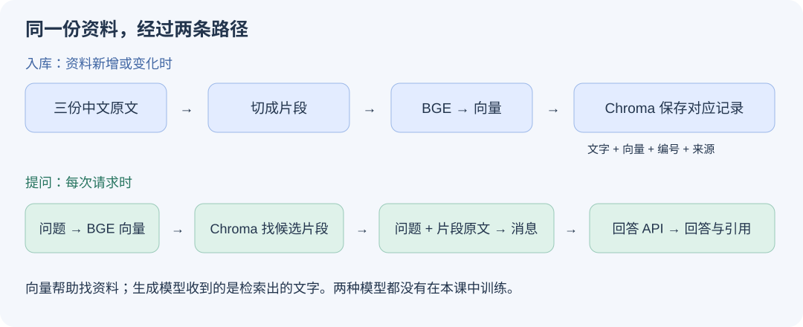

# 第三课 · 让助手先找资料，再回答

> 本课参考 Datawhale《动手学大模型应用开发》第三、四章。我们按你的学习节奏展开，不逐字搬运原课。原文与实现差异见 [SOURCES.md](SOURCES.md)。

你已经学过：客户端发 `POST /ask`，Uvicorn 接收，FastAPI 找到函数，服务再调用模型。你也部署过网站，因此这次跳过基础云部署，直接给现有能力加入检索。旧路线中的部署/网络章节保留作查阅，不是本课前置要求。

## 先看我们有什么、缺什么

这次做一个“提示词学习资料助手”。你问“提示词里使用分隔符有什么用？”，助手要从真实的中文课程资料中找依据并回答。我们用 Datawhale 仓库里的三份学习材料，主题是提示原则、迭代优化和文本概括。它们是公开教学资料，不是虚构客户订单，也不代表企业内部数据。

已有：第二课的模型接口、请求检查、超时处理，以及你的 Python 环境。

缺少：自动从多份资料中找到当前问题需要的部分。第二课每次固定放入整份借用说明；这次让程序选择内容。

完成后能看到：原文件 → 切出的片段 → 真正的向量 → 命中片段 → 发给模型的消息 → 回答和引用。



先分清两件事：**入库在资料新增或变化时做；检索在每次提问时做。** 不需要每提一个问题就把全部资料重新转成向量。

建议分三次学：A/B 资料与入库；C/D 检索与回答；E/F 改条件和接回接口。每次约 25–40 分钟，下载与讨论另计。没有单独 homework。

## A · 先打开原文，不急着读代码

在 VS Code 打开本课目录，新终端进入这里：

```bash
cd '/Users/yorkchen/文稿 - 陈尧的MacBook Pro/VibeCoding/llm-from-zero/cloud-ai-interview/03-rag-datawhale'
uv sync --locked
uv run --locked python prepare.py
```

`prepare.py` 只下载三份固定版本的公开 Markdown 文件，不读密钥，不调用模型。已有文件会保留，避免覆盖你做的修改。网络失败时重跑即可补齐尚未下载的文件。

打开 `data/source/2. 提示原则 Guidelines.md`，用编辑器搜索“分隔符”。先读它周围的文字，确定你心里知道问题的答案在哪里。**能用原文核对答案，才有条件判断检索与生成好不好。**

这里下载的是 Markdown 原文；其中代码块和示例输出也是资料的一部分，不会被执行。图片仍是原文链接，本课不解析图片。这意味着某些依赖图示的信息不在我们的检索范围内。

<details><summary>这一步只需要理解哪几行？</summary>

打开 `prepare.py` 的 `main()`：`urlopen` 读取公开文件，`write_bytes` 保存文件。下载地址里的长字符串是固定的 Git 提交编号，让后续实验引用同一版本。暂时不用继续追进网络库。
</details>

## B · 把原文变成可检索的资料库

```bash
uv run --locked python build.py --name first
```

第一次运行会下载真实中文向量模型 `BAAI/bge-small-zh-v1.5` 的 ONNX 文件，然后在本机 CPU 计算。FastEmbed 注册信息中的模型大小约 0.09 GB，缓存还有 tokenizer 等文件；以实际下载量为准。无需 GPU、embedding 账号或付费 embedding API。它不是随机向量，也不是手工关键词分数。

**DeepSeek/TokenHub 在后面负责写回答；这里的 BGE 模型只负责把文字转换成检索向量。** 原先计划的远程 embedding API 改成了本地推理，链路依然是真实 RAG。

运行完，按这个顺序打开文件：

| 打开什么 | 你会看到什么 | 它有什么用 |
|---|---|---|
| `artifacts/first/chunks.json` | 每段原文、编号、文件名和字符位置 | 核对切分有没有把意思切断 |
| `artifacts/first/vector-preview.json` | 第一个片段、完整向量及整体形状 | 看见文字确实转成了数值 |
| `artifacts/first/manifest.json` | 模型名、切分参数、片段数、维度 | 以后知道这个库怎样建出来 |
| `artifacts/first/source-snapshot/` | 这次入库时的原文副本 | 保留这次实验用的资料版本 |

Chroma 的数据库文件也在 `artifacts/first/`。**原文副本、片段展示文件和数据库不是三套不同答案**：前两者帮助我们观察与追溯，数据库保存用于检索的记录与索引。

本课默认每片最多 **300 个字符**，相邻片段的目标重叠量为 40 字符。程序会额外检查向量模型的 512 token 上限，过长时明确报错，避免静默截断。字符不等于 token，重叠也不保证每对片段恰好都是 40。切分器先尝试保留段落、句子，太长才继续切。它不会自动理解所有 Markdown 表格、代码和语义边界。

如果这次有 N 个片段，向量形状就是 `[N, 512]`：每个片段对应 512 个数字。本课只把它用于比较文字相关程度，不解释每一维“代表什么”，也不把它和生成模型内部的 token embedding 混为一谈。

**停下来观察：** 找到一个包含“分隔符”的片段。它是否包含完整解释？有没有只剩一段示例代码？先记录实际现象，不预设切分一定好。

<details><summary>现在只读这段代码</summary>

打开 `build.py` 的 `build()`，只看这三步：

```python
chunks = split_documents(docs, size, overlap)
vectors = embed([c["text"] for c in chunks])
coll.add(ids=..., documents=..., embeddings=..., metadatas=...)
```

最后一行把片段编号、文字、向量、来源信息作为对应记录一起保存。`metadatas` 是来源、字符位置这些附加信息，不是另一份向量。省略号是讲解用缩写，完整代码已经写好。

需要解释切分时才打开 `knowledge.py` 的 `split_documents()`；不用追进 Chroma 或 FastEmbed 的内部实现。
</details>

## C · 只找资料，暂时不让模型回答

```bash
uv run --locked python search.py '提示词里使用分隔符有什么用？'
```

你会看到三个真实命中片段，每个包含：编号、来源、原文中的字符范围、距离和完整文字。结果另存到 `artifacts/runs/`，不会覆盖上次记录。

这一步做了什么？

1. 用同一个 BGE 模型把问题转成一个 512 维向量。按模型推荐，在问题前加检索提示；资料本身不加这个提示。
2. 用问题向量查询 Chroma。
3. 返回最接近的三个候选片段，即 `top_k=3`。

这里打印的是 **cosine distance（余弦距离），越小越接近**，不是概率，也不是“回答正确率”。Chroma 使用近似向量检索；本课不声称任何规模下都会返回数学上绝对最近的三个。

**资料本身也需要判断：** 这份较早的原文把分隔符描述为可以“防止提示词注入”，这个说法过强。分隔符有助于区分内容，但不是可靠的安全边界，提示词注入的常用英文名是 Prompt Injection。我们保留原文便于追溯，不把原文里的每句话都当作事实。RAG 可能忠实复述错误资料，这也是要学会识别的情况。

**关键观察：** 三段里有没有你在 A 找到的解释？如果没有，先看切分和命中，不急着怪回答模型。`top_k=3` 只是返回数量，资料根本没有答案时也可能返回三段。

接着运行：

```bash
uv run --locked python search.py '这套资料作者的私人手机号是多少？'
```

它仍可能返回看起来相关的片段。请打开片段看：有支持答案的事实吗？**检索返回了内容，不等于资料有答案。** 不预设统一距离阈值；以后要用固定问题集评估阈值和拒答。

<details><summary>这一步对应什么代码？</summary>

`knowledge.py` 的 `search()`：`embed([question], is_query=True)` 得到问题向量；`db.query(...)` 查询已有索引。与 B 的区别：这次只有一个问题转向量，不是把全部资料重建一遍。
</details>

## D · 把命中片段放进消息，再调用真实模型

先只预览：

```bash
uv run --locked --env-file ../02-http-service/.env python answer.py '提示词里使用分隔符有什么用？'
```

没有 `--live` 就不会调用回答 API。打开它打印的 `*-answer.json`，查看 `request_body_without_credentials.messages`：

- `system`：回答规则，包括只依赖资料、依据不足要说明、使用片段编号引用。
- `user`：刚才检索到的片段文字、来源和你的问题。

**发给生成模型的是片段文字，不是那 512 个浮点数。** 向量用于找资料，文字用于让模型回答。这里没有训练或更新 DeepSeek 权重。

确认消息后，再执行一次真实调用：

```bash
uv run --locked --env-file ../02-http-service/.env python answer.py '提示词里使用分隔符有什么用？' --live
```

这会发送一次可能计费的模型请求，不自动重试。沿用第二课 `.env`，不需要复制或展示密钥。若仍出现 `upstream_auth`，先解决真实模型认证；检索成功不能证明模型账号可用。

查看答案旁的 `[chunk-xxxx]`，回到记录里的 `hits` 打开对应原文：**它真的支持这句话吗？** 程序的 `citation_check` 只能检查引用编号是否属于本次片段，不能证明结论正确。资料不足的回答可能没有引用，需要人工区分合理拒答和漏标。

再对 C 的“私人手机号”问题调用一次，观察模型有没有明确说明资料不足。不要把提示词里的拒答要求当成已经验证的保证。

前两次真实回答就够本段使用。实际 `usage` 和失败记录保存在实验文件中；没有用量就记未知，不推定免费。公开资料会随请求发送给你配置的模型平台。

## E · 改一个条件，比较结果

### 实验一：切小一点会更好吗？

```bash
uv run --locked python build.py --name small --size 150 --overlap 40
uv run --locked python search.py '提示词里使用分隔符有什么用？' --index small
```

只改变片段大小，问题、模型和 top_k 都保持一致。对比两份检索记录：命中段落是否更集中？有没有丢掉解释和例子的联系？不要用“距离数字更小”单独宣布效果更好。

### 实验二：改文件，旧资料库会自动知道吗？

在 `data/source/` 新建 `我的学习备注.md`，写一句明确标注为个人实验的内容，例如“本次学习演示的约定代号是海豚七号”。然后再次运行旧索引的检索。

本课程序会明确提示“原始资料已经变化，旧索引尚未更新”，停止查询。这是我们加的文件指纹检查，**不是 Chroma 自动监控文件变化**。停止而非默默返回旧资料，是为了让问题显现出来。

```bash
uv run --locked python build.py --name updated
uv run --locked python search.py '本次学习演示的约定代号是什么？' --index updated
```

这次是否找到新文件？本课为了容易理解做整库新建；大量资料通常需要增量更新、删除旧片段和版本管理，后续再实现。旧索引和原文快照仍保留，可核对，不覆盖你的记录。

### 一个短估算

假设有 1000 个片段，每个向量 512 维，每维按 float32 的 4 字节计算，纯向量数据占多少？还有哪些空间没有算进去？

<details><summary>核对思路</summary>

1000 × 512 × 4 = 2,048,000 字节，约 2.05 MB（十进制）。还没算文本、来源信息、索引、数据库开销、快照和模型缓存。不能把这个数当作整个目录大小。
</details>

## F · 最后才接回熟悉的 HTTP 服务

前面 `answer.py` 是直接运行的客户端流程，没有经过 FastAPI。现在才把相同检索和回答动作放进 `/ask`。

新开一个终端，仍在本课目录。若做了更新实验，使用 `updated`；没做则把下面改成 `first`：

```bash
RAG_INDEX=updated uv run --locked --env-file ../02-http-service/.env uvicorn server:app --host 127.0.0.1 --port 8002
```

这个终端保持运行。在另一个本课目录终端里，先做无模型调用的检查：

```bash
curl http://127.0.0.1:8002/health
```

它只说明进程活着、是否看见索引清单，不保证索引内容或模型凭据有效。然后使用第二课已经熟悉的客户端（一次真实回答调用）：

```bash
uv run --locked --env-file ../02-http-service/.env python ../02-http-service/client.py --url http://127.0.0.1:8002 --question '提示词里使用分隔符有什么用？'
```

这次响应除了答案，还包含 `retrieved_chunks`。沿其中的片段编号核对回答。**本课 HTTP 入口暂时只实现普通 JSON `/ask`，不要加 `--stream`。** 第二课的流式实现保留，后续理解 RAG 后再组合，避免同时调试两个新问题。

打开 `server.py`，只关注 `/ask` 中这两行：

```python
hits = await asyncio.to_thread(retrieve, body.question, index, 3)
result = await respond(body.question, hits, settings, body.max_tokens)
```

第一行先找资料。`to_thread` 让本机同步检索在另一个线程运行，避免直接卡住异步事件循环；不是增加一个模型 API。第二行把这些片段交给生成模型。其余输入检查、应用密钥、模型认证错误处理，都接着第二课理解。

本课服务为了观察简单，一次处理一条 RAG，其他请求等待；没有做生产级队列、限流、多用户文档隔离或连接池优化。启动后第一次查询还会加载 embedding 模型，首问耗时不能代表稳定性能。服务端只记录请求编号、耗时和命中数量；CLI 为学习保存完整公开片段，不能原样套用到敏感业务资料。

## 说给面试官听

用 60–90 秒解释：“我的 RAG 从文件到回答经历了什么？如果回答错了，我先检查哪里？”

请结合你实际记录：原文存在哪、如何切分、向量在哪里计算、索引里保存了什么、检索出了哪几段、最终模型看到了什么、引用是否支持答案。最后说一个你实际观察到的局限。

先完成一次解释再讨论，不需要背标准答案。教师的测试不算你的项目实践；本课是公开资料上的学习项目，不是已上线的企业知识库。

## 卡住时只解决眼前这一层

| 现象 | 先检查什么 |
|---|---|
| 下载 GitHub 资料失败 | 网络连接；重跑 prepare，不改密钥 |
| Hugging Face 模型下载失败 | 网络与缓存；重新执行 build，不会改成人工向量 |
| 目录已经存在 | 换 `--name`，不要删除学习记录 |
| 资料变化提示 | 用新名字重建库，查询时选同一个索引 |
| 返回 upstream_auth | 生成 API 认证问题，沿用第二课排查 |
| 向量检索有结果，答案不对 | 先逐段核对证据，再看实际 messages 和模型回答 |
| 端口 8002 被占用 | 换端口，客户端 --url 同步修改，不停止无关服务 |

学习观察可以记在 [NOTES.md](NOTES.md)，不用交 homework。验证范围与已知限制见 [VALIDATION.md](VALIDATION.md)。
